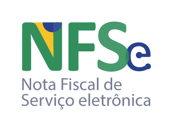

# _pynfse — Emissor Nacional de NFS-e & API ADN (v1.01)_

<p align="center">
  <a href="https://github.com/cleitonleonel/emissor_nfse">
    
  </a>
</p>

<p align="center">
  <i>Biblioteca e cliente Python para automação do Emissor Nacional de NFS-e e integração completa com a Sefin Nacional / ADN v1.01 (NT 1.101 — Reforma Tributária IBS/CBS).</i>
</p>

<p align="center">
<a href="https://github.com/cleitonleonel/emissor_nfse">
  
  
  
</a>
</p>

## O que o projeto faz

- **Autenticação híbrida**: login no portal web com **usuário/senha** ou com **certificado digital A1** (`.pfx`) via mTLS.
- **Integração Sefin Nacional / ADN v1.01 (`pynfse.adn`)**:
  - **Emissão e Substituição de NFS-e**: construção do XML `<DPS versao="1.01">` (`build_dps_xml`) e submissão via mTLS (`AdnNfseClient`).
  - **Eventos Oficiais (`pedRegEvento` v1.01)**: cancelamento (`e101101`) e cancelamento por substituição (`e105102`).
  - **Motor Tributário da Reforma Tributária (NT 1.101 / LC 214/2025)**: cálculo e validação de ISSQN, retenções federais (PIS, COFINS, IRRF, CSLL, INSS) e novos tributos **IBS/CBS** (`calcular_tributacao`, `validar_regras_ibscbs`), incluindo regras de transição 2026 vs. 2027+, diferimento, crédito presumido, tributação regular e compras governamentais.
  - **Catálogos Tributários Embarcados**: consulta rápida em memória a 18 CSTs, 138 `cClassTrib`, 338 serviços `cTribNac` (LC 116/2003), 1.739 correlações do Anexo VIII (`LC 116 x NBS x cIndOp x cClassTrib`) e 28 indicadores `cIndOp`.
  - **Validação XSD v1.01 e Assinatura XML-DSig**: validação offline com schemas XSD oficiais (`XsdValidator`) e assinatura digital `rsa-sha256` Enveloped (`DpsSigner`).
- **Consulta e Download de Notas (`ClienteNfseNacional`)**:
  - Consulta de **notas emitidas** e **notas recebidas** via portal web ou diretamente pela API de distribuição DFe do ADN por NSU.
  - Download de **XML** e **PDF/DANFS-e** organizados dinamicamente por cliente, tipo, ano, mês, status e extensão.
- **Geração Offline de DANFS-e em PDF (`DanfseGenerator`)**:
  - Gera o PDF da DANFS-e fiel ao layout oficial (com QR Code, brasão municipal e marca d'água para notas canceladas/substituídas) diretamente a partir do XML, contornando bloqueios de Captcha/403 do portal.
  - Fallback adicional para HTML de impressão quando o XML não estiver disponível localmente.

## Estrutura atual do repositório

- `main.py`: script de exemplo para autenticar, consultar e baixar notas
- `pynfse/`: pacote principal da biblioteca
  - `pynfse/adn/`: subpacote Sefin Nacional / ADN v1.01 (catálogos, motor IBS/CBS, construtores XML, validador XSD, assinador XML-DSig e cliente mTLS assíncrono)
  - `pynfse/assets/`: logotipos e brasões utilizados na geração da DANFS-e
- `tests/`: suíte de testes automatizados (`pytest`)
- `docs/`: documentação técnica, guia de API e enciclopédias de tags da NFS-e Nacional
- `scripts/`: scripts auxiliares (geração de badge de cobertura)
- `pyproject.toml`: metadados do pacote `pynfse` v0.2.0, dependências e configuração do `pytest` e `ruff`

## Requisitos

- Python 3.12+
- `pip` ou `poetry`
- Acesso ao portal do Emissor Nacional e/ou Certificado Digital ICP-Brasil A1 (`.pfx`)

## Instalação

### Com `pyproject.toml` (recomendado)

```bash
git clone https://github.com/cleitonleonel/emissor_nfse.git
cd emissor_nfse
python -m venv .venv
source .venv/bin/activate
pip install -e ".[dev]"
```

### Com `requirements.txt`

```bash
git clone https://github.com/cleitonleonel/emissor_nfse.git
cd emissor_nfse
python -m venv .venv
source .venv/bin/activate
pip install -r requirements.txt
```

## Configuração

Crie um arquivo `.env` na raiz do projeto com as credenciais e/ou certificado:

```env
NFSE_USUARIO=12345678000199
NFSE_SENHA=sua_senha_aqui
CERTIFICADO_PATH=/caminho/para/certificado.pfx
CERTIFICADO_SENHA=senha_do_certificado
```

## Exemplos rápidos de uso

### 1. Consulta e download de notas (`ClienteNfseNacional`)

```python
from pynfse import ClienteNfseNacional

cliente = ClienteNfseNacional(
    usuario="12345678000199",
    senha="sua_senha",
    caminho_pfx="/caminho/para/certificado.pfx",
    senha_pfx="senha_do_certificado",
)

cliente.autenticar()
resultado = cliente.listar_notas_emitidas("01/09/2025", "30/09/2025")

for nota in resultado.get("notas", []):
    situacao = nota.get("status_danfs-e", "gerada")
    data_emissao = nota.get("data_emissao")
    if nota.get("download_xml"):
        cliente.baixar_xml(nota["download_xml"], situacao, data_emissao)
    if nota.get("download_danfs-e"):
        cliente.baixar_pdf(nota["download_danfs-e"], situacao, data_emissao)
```

### 2. Cálculo Tributário IBS/CBS, Construção de DPS v1.01, Validação XSD e Assinatura (`pynfse.adn`)

```python
from pynfse import (
    DpsSigner,
    XsdValidator,
    build_dps_xml,
    calcular_tributacao,
)

# 1. Calcula tributos (ISSQN, Federais e IBS/CBS conforme NT 1.101)
tributacao = calcular_tributacao(
    valor_servicos=1000.00,
    regime_prestador="simples",
    cClassTrib="000001",
    cIndOp="030101",
    cTribNac="010101",
    cNBS="115021000",
)

# 2. Constrói o XML da DPS v1.01
xml_dps = build_dps_xml(
    prestador={"cnpj": "19495981000113", "codigo_municipio": "3201308", "regime": "simples"},
    tomador={"documento": "12345678000195", "razao_social": "TOMADOR LTDA"},
    servico={"cTribNac": "010101", "descricao": "Desenvolvimento de software", "valor": 1000.00},
    tributacao=tributacao,
    serie_dps="900",
    numero_dps=1,
    ambiente="homologacao",
)

# 3. Assina com Certificado A1 e valida contra o XSD oficial v1.01
signer = DpsSigner(pfx_path="/caminho/para/certificado.pfx", pfx_password="senha")
xml_assinado = signer.sign_xml(xml_dps, tag_to_sign="infDPS")

validacao = XsdValidator.validar_dps(xml_assinado)
assert validacao["valido"] is True
```

### 3. Geração de DANFS-e em PDF a partir do XML (`DanfseGenerator`)

```python
from pynfse import DanfseGenerator

gerador = DanfseGenerator("caminho/para/nota.xml", status="NORMAL")
gerador.gerar_pdf("caminho/para/danfse.pdf")
```

## Estrutura de downloads

Por padrão, os arquivos baixados pelo `ClienteNfseNacional` são organizados assim:

```text
downloads/
└── <cliente>/
    └── <tipo>/
        └── <ano>/
            └── <mes>/
                └── <status>/
                    └── <ext>/
                        └── <chave>.xml|pdf
```

## Testes e qualidade

O projeto usa `pytest` para testes automatizados e `ruff` para lint:

```bash
pytest -q
ruff check .
```

## Documentação

A documentação detalhada fica em `docs/`:

- [Página inicial](docs/index.md)
- [Guia de uso](docs/usage.md)
- [Referência da API](docs/api.md)
- [Arquitetura](docs/architecture.md)
- [Troubleshooting](docs/troubleshooting.md)
- [Dicionário de 360 Tags Únicas da NFS-e](docs/dicionario_360_tags_unicas_nfse.md)
- [Enciclopédia Completa de 645 Tags da NFS-e Nacional](docs/enciclopedia_completa_tags_nfse_nacional_645.md)

## Autor

**Cleiton Leonel Creton**

- Email: [cleiton.leonel@gmail.com](mailto:cleiton.leonel@gmail.com)
- GitHub: [@cleitonleonel](https://github.com/cleitonleonel)

---

**Última atualização:** Novembro de 2026
